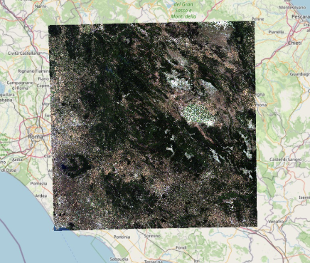
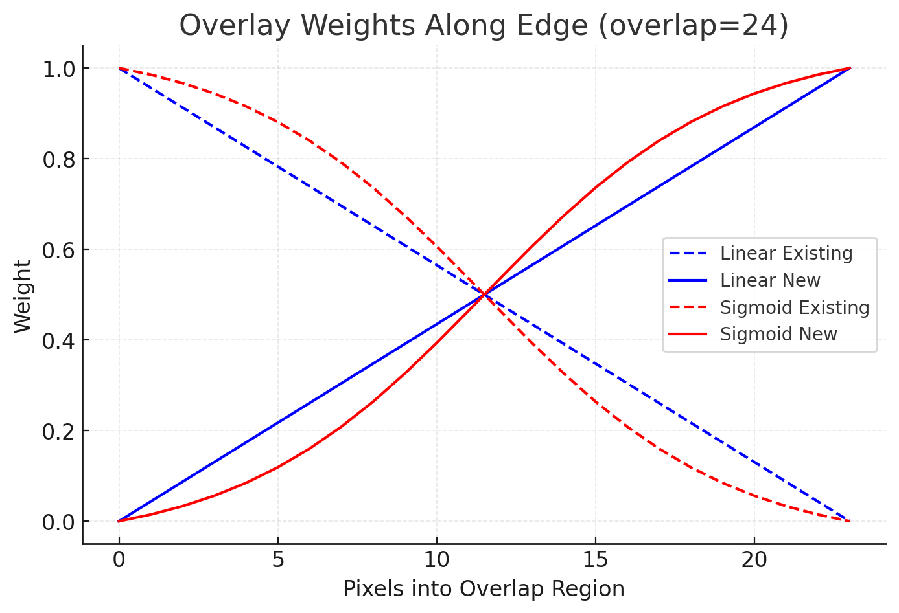

# OpenSR Utils

Super-resolution for large geospatial rasters with PyTorch or PyTorch Lightning
models. OpenSR Utils discovers input bands, batches overlapping windows, streams
predictions to disk, and blends them into a georeferenced GeoTIFF. Plain PyTorch
modules and Lightning modules both support batched CPU, CUDA and multi-GPU inference.

[](https://doi.org/10.5281/zenodo.17599309)



Install the package, or include the optional pretrained model loader:

```bash
pip install opensr-utils
pip install 'opensr-utils[model]'
```

CI runs on Python **3.12** with current compatible dependencies. Use
`opensr-utils[cog]` for COG conversion and
`opensr-utils[dev,cog]` for development. For current model installations, Python
**3.12–3.14** supports both SEN2SR and ESA SRGAN.

## Python usage

Provide an input, model and output. The device, batching, tiling, temporary
storage, stitching and cleanup have defaults:

```python
from opensr_utils import super_resolve

output = super_resolve('scene.SAFE.zip', model='LDSRS2', output='results/scene_sr.tif')
```

Pass your own `torch.nn.Module` or `LightningModule` instead of a model name.
`model=None` performs bilinear interpolation and requires no pretrained weights.
The scale is taken from the model's declared `factor`, falling back to 4.
Use `factor=1` for inference without upscaling; an explicit factor must match a
named model's actual scale.

```python
output = super_resolve(
    'scene.tif', model=my_model, output='results/sr.tif',
    factor=2, batch_size=8, device='cpu', cleanup=False,
)
```

For preparation, inspection and explicit execution, the existing class remains
available. Construction prepares the run without invoking the model:

```python
from opensr_utils import large_file_processing

with large_file_processing(
    root='scene.tif', model=my_model, output_path='results/sr.tif', factor=2,
) as job:
    print(len(job.image_meta['image_windows']))
    output = job.run()
```

The one-call API always executes once and closes raster handles. The class also
has `close()` for callers who do not use a context manager.

## Model examples

Runnable examples live in **[examples/](examples/README.md)**. Each script has
`--help`, device selection, batching, tiling and output options. Start with
Python 3.12–3.14 and install the extra for your chosen model:

```bash
python -m pip install 'opensr-utils[sen2sr-ldsr]'  # SEN2SR + LDSR-S2 backbone
python -m pip install 'opensr-utils[model]'        # LDSR-S2 RGB-NIR alone
python -m pip install 'opensr-utils[srgan]'        # ESA SRGAN RGB-NIR

# All ten supported Sentinel-2 bands, with LDSR-S2 as the RGB-NIR backbone.
python examples/run_sen2sr.py scene.SAFE.zip --device cuda --output results/all_bands.tif

# Separate four-band RGB-NIR diffusion example.
python examples/run_ldsrs2.py scene.SAFE.zip --device cuda --output results/rgbn.tif

# Four-band ESA SRGAN example.
python examples/run_esasrgan.py scene.tif --device cuda --output results/srgan.tif

# Interpolation and advanced generic options.
python examples/run_model.py --help
python examples/run_model.py scene.tif --model none --factor 1 --output results/check.tif
```

| Example | Model and bands | Scale |
| --- | --- | --- |
| `run_sen2sr.py` | SEN2SRLite all-band fusion with an **LDSR-S2 RGB-NIR backbone**. Input/output: **B02, B03, B04, B05, B06, B07, B08, B8A, B11, B12**. | 10 m reference grid → 2.5 m |
| `run_ldsrs2.py` | LDSR-S2 alone. Input/output: **B04, B03, B02, B08** (RGB-NIR). | 4× |
| `run_esasrgan.py` | ESA SRGAN `RGB-NIR` preset. Input/output: **B04, B03, B02, B08**. | 4× |

“All bands” means the ten bands supported by SEN2SR; B01, B09 and B10 are not
model inputs. The all-band example retains SEN2SR's learned red-edge/SWIR fusion
stages and replaces its RGB-NIR generator with LDSR-S2. For SAFE/S2GM folders,
it explicitly resamples native 20 m bands onto the RGB 10 m reference grid using
windowed nearest-neighbor reads, then applies the learned model. It writes ten
labeled bands at 2.5 m, preserving the georeferenced footprint and validity mask.
No full intermediate stack is needed.

The generic named `SEN2SR` loader still defaults to its four-band RGB-NIR
variant for compatibility. The all-band example explicitly selects
`variant="main", backbone="ldsrs2"`.

The same composition is available in Python:

```python
from opensr_utils import super_resolve
from opensr_utils.model_utils import get_model

# Downloads SEN2SR fusion artifacts and the LDSR-S2 backbone on first use.
model = get_model("SEN2SR", variant="main", backbone="ldsrs2", device="cpu")
output = super_resolve(
    "scene.SAFE.zip", model, "results/all_bands.tif",
    device="auto", batch_size=1, resample_inputs=True,
)

# LDSR-S2 alone produces only R, G, B and NIR.
from opensr_utils.model_utils.ldsrs2 import load_ldsrs2

rgbn_model = load_ldsrs2()
output_rgbn = super_resolve("scene.SAFE.zip", rgbn_model, "results/rgbn.tif")
```

Standalone GeoTIFFs must already share a grid. Band descriptions select and order
model channels automatically; unlabeled inputs must use the order in the table,
or supply `--bands` / `band_indexes` explicitly. Fixed 128×128 model tiles are
replicate-padded and cropped for smaller edge windows. The SRGAN adapter retains
the official histogram matching and EMA inference path.

See [examples/README.md](examples/README.md) for local weights, offline inference
and diffusion sampling options. The root `demo.py` is a local, ignored scratch
script; published examples, tests and source distributions use `examples/`.

## Command line

```bash
# Pretrained LDSR-S2; model installation/download access is required.
opensr-run scene.SAFE.zip LDSRS2 -o results/scene_sr.tif

# Four-band pretrained models, with optional model extras installed.
opensr-run scene.SAFE SEN2SR -o results/sen2sr.tif --batch-size 1
opensr-run scene.tif SRGAN -o results/srgan.tif --batch-size 4

# Interpolation, using the automatic device and default 4× scale.
opensr-run scene.tif -o results/interpolated.tif

# Advanced throughput and blending settings.
opensr-run scene.tif LDSRS2 -o results/sr.tif \
  --device cuda --gpus 0 1 --batch-size 8 \
  --window-size 128 128 --overlap 12 --eliminate-border-px 2 --save-preview
```

`python -m opensr_utils` provides the same interface. Existing underscore options
such as `--window_size` and `--keep_temp` remain aliases. Model-loading and
processing failures report a diagnostic and return a nonzero exit status.

| Setting | Default | Meaning |
| --- | --- | --- |
| `output` / `-o` | `sr.tif` beside resolved input | Python class uses `output_path`; S2GM defaults inside its folder. |
| `window_size` / `--window-size` | `(128, 128)` | LR window width and height, clipped for small inputs. |
| `factor` / `--factor` | Model scale, otherwise `4` | Positive integer model scale; declared model scales are validated. |
| `overlap` / `--overlap` | `8` | Even overlap in LR pixels, smaller than both window dimensions. |
| `eliminate_border_px` / `--eliminate-border-px` | `0` | Even interior border discard in LR pixels; overlap minus discard must be at least 4 when overlap is nonzero. |
| `device` / `--device` | `auto` | CUDA when available, otherwise CPU; explicit `cpu` and `cuda` are supported. |
| `gpus` / `--gpus` | GPU 0 for CUDA | GPU index or list of indices in Python; list of IDs on CLI. |
| `batch_size` / `--batch-size` | `16` | Tune for model memory use; incomplete final batches are preserved. |
| `num_workers` / `--num-workers` | `0` | Increase for parallel raster reads when I/O limits throughput. |
| `prefetch_factor` / `--prefetch-factor` | `2` | Positive batches per worker; ignored with zero workers. |
| `output_units` / `--output-units` | Model units, otherwise `normalized` | Explicit prediction units, described below. |
| `resample_inputs` (Python) | `False` | Explicitly map folder bands to the selected reference grid; enabled by the all-band SEN2SR example. |
| `band_indexes` / `--bands` | Model descriptions or native order | Select 1-based channels from a file in model input order. |
| `checkpoint` / `--checkpoint` | Download official preset | Local SEN2SR MLSTAC directory/export or ESA SRGAN weights. |
| `model_config` / `--config` | Preset config | ESA SRGAN YAML accompanying local weights. |
| `cache_dir` / `--cache-dir` | Loader cache | Directory for downloaded artifacts. |
| `download=False` / `--no-download` | Download permitted | Require local model artifacts. |
| `compressed_patches` / `--compressed-patches` | `False` | Smaller NPZ intermediates; NPY avoids compression overhead. |
| `cleanup=False` / `--keep-temp` | Cleanup enabled | Keep every prediction and its manifest after a successful run. |
| `overwrite` / `--overwrite` | `False` | Allow atomic replacement of a previous successful output. |
| `delete_input_zip` / `--delete-input-zip` | `False` | Delete the source ZIP only after usable input validation. |
| `save_preview` / `--save-preview` | `False` | Save inference previews, a georeferenced crop and LR/SR comparisons. |
| `debug` / `--debug` | `False` | Predict at most 100 windows, keep diagnostics, and create no final product. |

## Input and output contracts

Supported inputs are Rasterio-readable files, Sentinel-2 `.SAFE` directories,
ZIP archives containing a SAFE product, and S2GM band folders. SAFE/S2GM common
channels are ordered **R, G, B, NIR** (B04, B03, B02, B08), followed by additional
spectral channels on the selected grid. Auxiliary bands such as AOT, WVP and TCI
are excluded. Generic PyTorch models retain native file band order and channel count; adapters
with declared spectral inputs select named or explicitly indexed bands.
SAFE discovery prefers 10 m common bands. Bands on other-sized grids are omitted;
same-sized bands with different transforms or CRSs are rejected. Set
`resample_inputs=True` explicitly to read folder bands on the selected reference
grid, as in the all-band example; default discovery performs no reprojection. Models must accept the discovered channels; model output
channel counts may differ from input counts. LDSR-S2 expects Sentinel-2 RGB/NIR
inputs; use a model suited to mosaics for S2GM data.

Inputs are float32 values divided by 10000 and clipped to [0,1]. Masked or
nonfinite input pixels are filled with zero for the model. Predictions must be
finite tensors shaped `(batch, channels, height * factor, width * factor)` with
matching batch and metadata sizes. They are rounded and saved as uint16:

- `output_units='normalized'`: clip to [0,1] and multiply by 10000.
- `output_units='reflectance'`: clip existing digital-number values to [0,10000].

The former brightness-based units heuristic has been removed. A dark model
output of `5` means 5 DN only with `output_units='reflectance'`; the normalized
contract clips it to 1 and saves 10000 DN. Input normalization is unchanged.

The output preserves CRS and the complete affine footprint, including rotation
and shear. Source validity is the intersection of every input band's Rasterio
mask and finite values. That validity is upscaled by nearest-neighbor mapping
into an **internal GeoTIFF mask**, independently of prediction values. Valid
zero predictions remain valid. A common source nodata value is retained if
representable as uint16; otherwise nodata metadata is cleared. The internal
mask is authoritative; values under masked pixels are unspecified. Applications
should read masks, for example with `rasterio.open(output).read(masked=True)`.

## Output safety and diagnostics

Source rasters are protected against output-path, symlink and hardlink
collisions. A successful run atomically publishes a staging file beside the
final destination, after every patch and full raster coverage have validated.
An overwrite failure leaves the previous output intact. Publishing without
overwrite also protects against another job creating the destination during
stitching. Successful overwrites remove stale external mask/overview sidecars. Failed runs keep
patches and diagnostics for inspection. Retention keeps the manifest and every
patch it references; use that manifest to inspect coordinates, channels and units.
Logs and temporary files have separate run-specific directories beside the output.

Debug runs return the retained `index.json` path, even if fewer than 100 windows
exist. They never publish or replace a final raster. Run again with `debug=False`
for a complete product; normal full-coverage checks still apply.

For multiple GPUs, pass `gpus=[0, 1]` and let Lightning launch processes. Distributed
sampling never pads or duplicates windows and permits empty ranks. Externally
launched jobs must share an output filesystem and a unique `OPENSR_RUN_ID` across
ranks before construction (an already initialized process group can share it
automatically). `LOCAL_WORLD_SIZE` describes devices per node; global rank owns
publication. Distributed tests exercise real CPU/Gloo communication, with optional
GPU coverage where hardware is available; they do not establish multi-node
filesystem or GPU-driver compatibility for every deployment.

## Blending and development

Overlaps use weighted accumulation so four-way intersections and valid zeros
are handled consistently. Interior border discard does not remove the outer
image boundary. The lower-level stitcher supports linear, sigmoid and cosine
profiles; the pipeline uses sigmoid weighting.



See [tests/README.md](tests/README.md) for behavior tests, branch coverage,
real JP2 fixtures, distributed checks and model-adapter contracts. The runnable
[examples](examples/README.md) explain pretrained downloads and SR product creation.

## Citation

```bibtex
@software{Donike_OpenSR_Utils_2025,
  author = {Donike, Simon and Gomez-Chova, Luis},
  title = {OpenSR-Utils},
  license = {MIT},
  url = {https://github.com/ESAOpenSR/opensr-utils},
  year = {2025},
  doi = {10.5281/zenodo.17599310}
}
```
